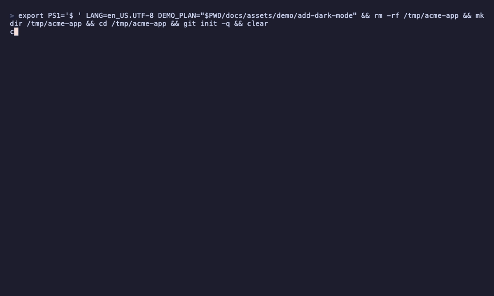

<p align="center">
  <picture>
    <source media="(prefers-color-scheme: dark)" srcset="docs/assets/compagnon-logo-dark.svg">
    
  </picture>
</p>

# Compagnon

**Planifiez avec Claude avant qu'il ne code.**

[](https://github.com/mairistem/compagnon/actions/workflows/ci.yml)
[](https://github.com/mairistem/compagnon/releases/latest)
[](LICENSE)
[](https://github.com/mairistem/compagnon/releases/latest)

[English](README.md) · Français

Compagnon vous permet, avec Claude Code, de vous mettre d'accord sur ce
qu'il faut construire avant d'écrire la moindre ligne de code : Claude
rédige un plan court, vous le validez, puis Claude construit exactement
cela — et le plan reste dans votre dépôt.

<p align="center">
  
</p>

## Démarrer

1. **Installez Compagnon** — sans chaîne d'outils Rust. Sur macOS et Linux :

   ```bash
   curl -sSL https://raw.githubusercontent.com/mairistem/compagnon/main/install.sh | sh
   ```

   Sur Windows (PowerShell) :

   ```powershell
   iwr -useb https://raw.githubusercontent.com/mairistem/compagnon/main/install.ps1 | iex
   ```

   Les deux scripts vérifient le SHA-256 du binaire qu'ils téléchargent. Les
   autres façons d'installer sont dans le
   [guide d'installation](https://mairistem.github.io/compagnon/fr/installation.html).

2. **Préparez votre dépôt**, une fois, à sa racine :

   ```bash
   compagnon init
   ```

3. **Demandez un change à Claude Code**, avec vos mots — « prépare un plan
   pour un mode sombre qui suit le réglage du système » — ou avec le
   raccourci :

   ```text
   /compagnon-propose ajoute un mode sombre qui suit le réglage du système
   ```

   Claude rédige le plan et attend votre accord.
   [Votre premier change](https://mairistem.github.io/compagnon/fr/quickstart.html) parcourt le cycle complet.

## Trouver votre chemin

La documentation propose un parcours par profil :

- [Je découvre les agents IA](https://mairistem.github.io/compagnon/fr/choose-your-path.html#je-découvre-les-agents-ia)
- [Je ne code pas, je relis et valide des plans](https://mairistem.github.io/compagnon/fr/choose-your-path.html#je-ne-code-pas-je-relis-et-valide-des-plans)
- [Je développe avec Compagnon](https://mairistem.github.io/compagnon/fr/choose-your-path.html#je-développe-avec-compagnon)
- [Je configure Compagnon pour mon équipe](https://mairistem.github.io/compagnon/fr/choose-your-path.html#je-configure-compagnon-pour-mon-équipe)
- [Je contribue à Compagnon](https://mairistem.github.io/compagnon/fr/choose-your-path.html#je-contribue-à-compagnon)

## Fonctionnement

Chaque change suit le même cycle, avec une skill Claude Code par étape :

```text
┌───────────┐    ┌───────────┐    ┌───────────┐
│  propose  │───▶│   apply   │───▶│  archive  │
│ planifier │    │ réaliser  │    │ classer   │
└───────────┘    └───────────┘    └───────────┘
```

Le plan vit dans `_compagnon/changes/` : pourquoi, quoi, comment, les
tâches, et un **delta de spec** qui énonce le comportement ajouté :

```markdown
### Requirement: Le thème choisi est mémorisé

L'application SHALL restaurer le dernier thème choisi par l'utilisateur, sur chaque appareil où il se connecte.

#### Scenario: Utilisateur de retour

- **GIVEN** un utilisateur qui a choisi le thème sombre sur son ordinateur portable
- **WHEN** il se connecte sur son téléphone
- **THEN** l'application s'affiche avec le thème sombre
```

À l'archivage, Compagnon fusionne le delta dans les specs vivantes de
`_compagnon/specs/`, qui décrivent toujours ce que fait le système
aujourd'hui. Les décisions d'architecture, une fois acceptées, sont
scellées : Claude les suit au lieu d'en redébattre. Compagnon n'appelle
jamais de modèle lui-même : Claude Code écrit, et Compagnon lui dit quoi
écrire, où, et sous quelles contraintes.

## Développé avec Compagnon

Chaque change de ce dépôt a été planifié, relu et archivé avec Compagnon
lui-même. Parcourez [les specs vivantes](_compagnon/specs/),
[les changes archivés](_compagnon/changes/archive/),
[un compte rendu de revue](_compagnon/changes/archive/2026-10-13-review-record/review.md)
et [les décisions scellées](_compagnon/decisions/).

## Comparaison

Compagnon fait partie des nombreux outils de développement piloté par les specs
destinés aux agents de code. Voici une synthèse des fonctionnalités
documentées, en septembre 2026 :

| | Compagnon | [OpenSpec](https://github.com/Fission-AI/OpenSpec) | [Spec Kit](https://github.com/github/spec-kit) |
|---|---|---|---|
| Distribution | Binaire natif unique | Paquet npm (Node.js) | CLI Python (installée avec uv) |
| Agents pris en charge | Claude Code | Plus de 30 outils | De nombreux agents, dont GitHub Copilot |
| Deltas de specs fusionnés dans des specs vivantes | Oui | Oui | Non — des artefacts par fonctionnalité |
| Décisions d'architecture (ADR) | Oui, scellées contre les modifications | Non | Non — une constitution de projet à la place |
| Partage entre dépôts | Sources en lecture seule, épinglées par commit git | Stores (bêta) | — |
| Licence | MIT | MIT | MIT |

Compagnon s'appuie directement sur les idées d'OpenSpec : le cycle
propose → apply → archive, le change comme unité de travail, et les opérations
de delta `ADDED` / `MODIFIED` / `REMOVED` / `RENAMED` viennent toutes
d'OpenSpec. Si vous avez besoin d'un autre agent que Claude Code, OpenSpec et
Spec Kit vous conviendront mieux. Si une information de ce tableau n'est plus à
jour, merci d'ouvrir une issue.

## Documentation

La documentation complète est sur
**[mairistem.github.io/compagnon](https://mairistem.github.io/compagnon/fr/)**. Elle est aussi intégrée au
binaire, lisible hors ligne :

```bash
compagnon docs
```

## Contribuer

Les contributions sont les bienvenues. Compagnon est développé avec Compagnon : les
petites corrections passent par une pull request classique, et tout le reste
commence par un change Compagnon. Consultez [CONTRIBUTING.fr.md](CONTRIBUTING.fr.md),
ainsi que la [feuille de route](ROADMAP.md) (en anglais) pour ce qui est prévu.

Merci de signaler les problèmes de sécurité en privé, comme indiqué dans
[SECURITY.md](SECURITY.md) (en anglais). Ce projet applique un
[code de conduite](CODE_OF_CONDUCT.md) (en anglais).

## Licence

Compagnon est distribué sous [licence MIT](LICENSE).

Compagnon s'inspire d'[OpenSpec](https://github.com/Fission-AI/OpenSpec), de
Fission AI, également distribué sous licence MIT.
