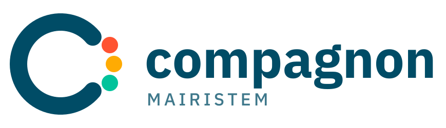
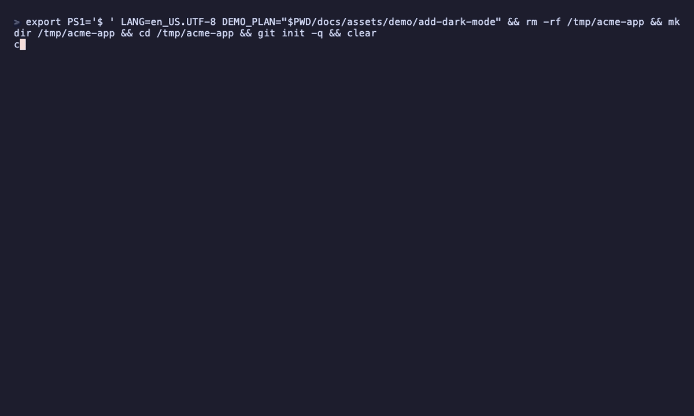

<p align="center">
  <picture>
    <source media="(prefers-color-scheme: dark)" srcset="docs/assets/compagnon-logo-dark.svg">
    
  </picture>
</p>

# Compagnon

**Plan with Claude before it codes.**

[](https://github.com/mairistem/compagnon/actions/workflows/ci.yml)
[](https://github.com/mairistem/compagnon/releases/latest)
[](LICENSE)
[](https://github.com/mairistem/compagnon/releases/latest)

English · [Français](README.fr.md)

Compagnon lets you and Claude Code agree on what to build before a line of
code is written: Claude writes a short plan, you approve it, then Claude
builds exactly that — and the plan stays in your repository.

<p align="center">
  
</p>

## Getting started

1. **Install Compagnon** — no Rust toolchain needed. On macOS and Linux:

   ```bash
   curl -sSL https://raw.githubusercontent.com/mairistem/compagnon/main/install.sh | sh
   ```

   On Windows (PowerShell):

   ```powershell
   iwr -useb https://raw.githubusercontent.com/mairistem/compagnon/main/install.ps1 | iex
   ```

   Both scripts verify the SHA-256 of the binary they download. Other ways
   are in the [installation guide](https://mairistem.github.io/compagnon/en/installation.html).

2. **Set up your repository**, once, at its root:

   ```bash
   compagnon init
   ```

3. **Ask Claude Code for a change**, in plain words — "plan a dark mode that
   follows the system setting" — or with the shortcut:

   ```text
   /compagnon-propose add a dark mode that follows the system setting
   ```

   Claude writes the plan and waits for your approval. [Your first
   change](https://mairistem.github.io/compagnon/en/quickstart.html) walks through the whole cycle.

   Working from Jira? Say "Prepare a plan for PROJ-123": Claude reads the
   ticket, without changing it, and cites it at the top of the plan. See
   [Start from a Jira ticket](https://mairistem.github.io/compagnon/en/guides/mcp.html).

## Find your way

The documentation reads as a path in five steps — discover, get started,
every day, understand, for your team. Start with
[Compagnon in two minutes](https://mairistem.github.io/compagnon/en/introduction.html)
and follow "Next step" at the end of each page.

## How it works

Every change follows the same cycle, with one Claude Code skill per step:

```text
┌───────────┐    ┌───────────┐    ┌───────────┐
│  propose  │───▶│   apply   │───▶│  archive  │
│ plan it   │    │ build it  │    │ file it   │
└───────────┘    └───────────┘    └───────────┘
```

The plan lives in `_compagnon/changes/`: why, what, how, the tasks, and a
**spec delta** stating the behavior it adds:

```markdown
### Requirement: The chosen theme is remembered

The application SHALL restore the theme the user last picked, on every device they sign in from.

#### Scenario: Returning user

- **GIVEN** a user who picked the dark theme on their laptop
- **WHEN** they sign in on their phone
- **THEN** the application renders with the dark theme
```

On archiving, Compagnon merges the delta into the living specs of
`_compagnon/specs/`, which always describe what the system does today.
Architecture decisions, once accepted, are sealed: Claude follows them
instead of re-debating them. Compagnon never calls a model itself: Claude
Code writes, and Compagnon tells it what to write, where, and under which
constraints.

## Built with Compagnon

Every change to this repository was planned, reviewed and archived with
Compagnon itself. Browse [the living specs](_compagnon/specs/),
[the archived changes](_compagnon/changes/archive/),
[a review record](_compagnon/changes/archive/2026-10-13-review-record/review.md)
and [the sealed decisions](_compagnon/decisions/).

## Comparison

Compagnon is one of several spec-driven tools for coding agents. A summary of
documented features, as of September 2026:

| | Compagnon | [OpenSpec](https://github.com/Fission-AI/OpenSpec) | [Spec Kit](https://github.com/github/spec-kit) |
|---|---|---|---|
| Distribution | Single native binary | npm package (Node.js) | Python CLI (installed with uv) |
| Supported agents | Claude Code | 30+ tools | Many, including GitHub Copilot |
| Spec deltas merged into living specs | Yes | Yes | No — artifacts per feature |
| Architecture decisions (ADRs) | Yes, sealed against edits | No | No — a project constitution instead |
| Sharing across repositories | Read-only sources pinned by git commit | Stores (beta) | — |
| License | MIT | MIT | MIT |

Compagnon builds directly on OpenSpec's ideas: the propose → apply → archive
cycle, changes as the unit of work, and the `ADDED` / `MODIFIED` / `REMOVED` /
`RENAMED` delta operations all come from OpenSpec. If you need an agent other
than Claude Code, OpenSpec and Spec Kit are the better fit. If something in
this table is out of date, please open an issue.

## Documentation

The full documentation is at
**[mairistem.github.io/compagnon](https://mairistem.github.io/compagnon/en/)**. It is also embedded in the
binary, readable offline:

```bash
compagnon docs
```

## Contributing

Contributions are welcome. Compagnon is developed with Compagnon: small fixes go
through a regular pull request, and everything else starts as a Compagnon change.
See [CONTRIBUTING.md](CONTRIBUTING.md), and the [roadmap](ROADMAP.md) for what
is planned.

Please report security issues privately, as described in
[SECURITY.md](SECURITY.md). This project follows a
[code of conduct](CODE_OF_CONDUCT.md).

## License

Compagnon is released under the [MIT License](LICENSE).

Compagnon is inspired by [OpenSpec](https://github.com/Fission-AI/OpenSpec), by
Fission AI, also released under the MIT License.
